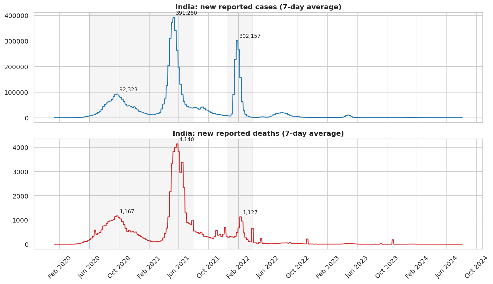

# Covid-19 Case Study (Python): Global Patterns and India's Pandemic

A Python analysis of public Covid-19 data covering which countries were hit hardest, how India's waves unfolded, how India compares with other large countries, and which country characteristics go with higher reported deaths.



## Questions answered
1. Which countries were hit hardest, with and without adjusting for population?
2. How did India's cases and deaths evolve across waves?
3. How does India compare with nine other large countries?
4. Do age, income and vaccination coverage relate to reported deaths across countries?

## Key findings
- **Totals vs per capita:** the United States had the most reported cases (103.4M), but the highest deaths per million among countries with 1M+ people was Peru (6,601). Per-million measures change the ranking.
- **India's waves:** the second wave peaked at 391,280 cases a day on 9 May 2021 and 4,140 deaths a day on 23 May 2021. Deaths peaked two weeks after cases.
- **Third wave was less deadly per case:** it peaked at 302,157 cases a day (23 Jan 2022) with 5.5 deaths per 1,000 reported cases, against 13.0 in the second wave. The data cannot prove why. Vaccination and prior infection are possible factors.
- **India vs peers:** India's reported deaths per million (374) are the lowest of the 10 large countries analysed, against 3,494 for the United States. Official counts are widely thought to understate India's true toll, so this is not a ranking of outcomes.
- **Vaccination:** India reached 50 first doses per 100 people on 21 October 2021, and peaked at 72.5 first doses and 67.2 full doses per 100.
- **What goes with reported deaths across 151 countries:** median age (Spearman 0.79) and GDP per capita (0.66) correlate strongly, because older, richer countries had more at-risk people and recorded deaths more completely. The correlation with vaccination (0.34) is confounded and is not a vaccine effect.

| Chart | Shows |
|---|---|
| `images/01_global_top10.png` | Top 10 by total cases and by deaths per million |
| `images/02_cfr_by_continent.png` | Reported case fatality rate by continent |
| `images/03_india_waves.png` | India's cases and deaths with wave peaks |
| `images/04_deaths_per_million_selected.png` | Deaths per million, 10 large countries |
| `images/05_india_vaccination_policy.png` | India's policy stringency and vaccination |
| `images/06_drivers_scatter.png` | Age and vaccination vs deaths per million |

## Approach
- **Data quality checks:** duplicates, negative counts, missing values and each country's last reporting date.
- **Cleaning:** kept real countries only (removed OWID aggregates such as "World"), kept India rows where cases were actually reported, and used 7-day averages to smooth reporting noise.
- **Measures:** deaths per million, case fatality rate (reported deaths / reported cases) and deaths per 1,000 cases within each wave.
- **Analysis:** top-10 rankings, continent summary, wave detection by calendar windows, cross-country comparison and Spearman correlations.

## Data
Our World in Data (OWID) Covid-19 dataset, compiled from Johns Hopkins University CSSE, WHO and national sources. Credit OWID if you reuse it.
Two small extracts are included so the notebook runs offline:
- `data/covid_selected_countries_daily.csv`: daily data for 10 large countries
- `data/covid_country_snapshot.csv`: latest values for every country

`src/make_extract.py` rebuilds both from the full OWID file.

## Repository structure
```
notebooks/covid19_case_study.ipynb   full analysis with outputs
src/make_extract.py                  builds the data extracts from the OWID file
data/                                extracts and key_metrics.json
images/                              saved charts
requirements.txt
```

## How to run
```bash
pip install -r requirements.txt
jupyter notebook notebooks/covid19_case_study.ipynb
```

## Limitations
- These are reported numbers. Testing and death-recording rules differ by country, and excess-mortality estimates for India are far higher than reported deaths.
- Countries stopped reporting at different dates (latest data is August 2024).
- Wave windows are set by date from visible peaks. Variant labels are by timing only.
- Country-level correlations do not show cause and effect. Countries under 1M people are excluded from per-million rankings.

## Tools
Python, pandas, NumPy, Matplotlib, Seaborn, Jupyter

## Author
Satyam Arora | [LinkedIn](https://www.linkedin.com/in/satyam-arorab83a3648)
